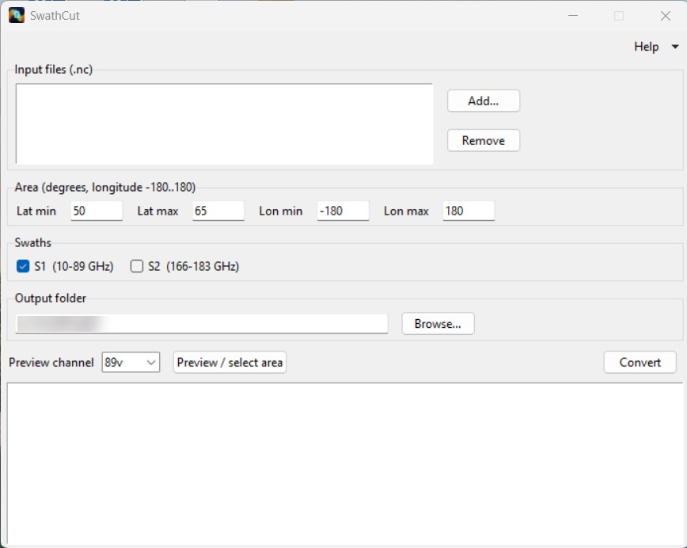
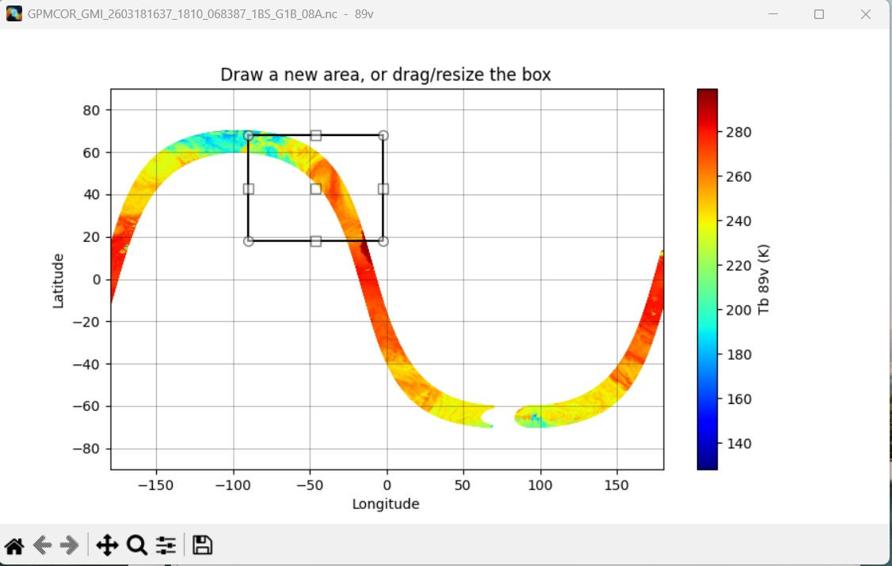

# SwathCut

Cut a latitude/longitude area out of satellite microwave swath files (`.nc`)
and save it as plain text: brightness temperatures from **GPM GMI** and
**GOSAT-GW AMSR3**, and AMSR3 **Level-2** products.

## Supported files

| Instrument | Product | File name contains | Output |
|---|---|---|---|
| GPM GMI | L1B brightness temperature | `1BS` / `1B.GPM.GMI` | one file per swath (S1, S2) |
| GOSAT-GW AMSR3 | L1B brightness temperature | `S1BTBB` | `low_freq`, `89GHz`, `165GHz`, `183GHz` files |
| GOSAT-GW AMSR3 | L1R resampled brightness temperature | `S1RTBR` | one `low_freq` file, AMSR2 layout |
| GOSAT-GW AMSR3 | L2 swath products: TPW, CLW, PRC, SST, SSW, ASW, … | `S2…` | one file, a column per field |

AMSR3 files are available from JAXA [G-Portal](https://gportal.jaxa.jp/).

## Download

Get `SwathCut.exe` from the [Releases](../../releases) page and run it.
No Python or other installation is needed (Windows 10/11, 64-bit).

## Use

1. **Add...** one or more `.nc` files of the kinds listed above.
2. Set the area: type Lat/Lon limits, or press **Preview / select area** and
   draw, drag or resize the box on the swath map.
   Longitudes are −180…180; *Lon min > Lon max* selects a box across the 180° meridian.
3. GMI only: tick the swaths **S1** (10–89 GHz) and/or **S2** (166–183 GHz).
4. Choose the output folder and press **Convert**.

Granules that do not cross the area are skipped. The area and the input and
output folders are remembered between runs.

## Screenshots




## Output format

```
Begin: 2026-03-18T17:15:00.039Z End: 2026-03-18T17:22:33.783Z
Start Orbit: 68387 Stop Orbit: 68387
Equatorial Cross. Lon: 179.82  Equatorial Cross. time: 2026-03-18T17:00:43.793Z
#lat #lon #10v #10h #18v #18h #23v #36v #36h #89v #89h
50.02 -159.22 163.71 90.32 178.79 106.65 189.58 206.47 143.33 237.57 189.63
...
```

Three header lines (time, orbit, equator crossing), a column line, then one
pixel per row: latitude, longitude (degrees) and the values.

- **GMI L1B** (above): brightness temperatures in K; pixels with missing data are
  dropped. S2 files have the columns `#166v #166h #183+-3v #183+-7v`.
- **AMSR3 L1R** (`…_low_freq_….txt`): the same 12 channels as the AMSR2
  `*_low_freq.txt` files, all at the 6.9 GHz footprint:
  `#lat #lon #6-v #6-h #7-v #7-h #10-v #10-h #18-v #18-h #23-v #23-h #36-v #36-h`
  (10 = 10.65 GHz). Scans overlapping the neighbouring granules are dropped.
- **AMSR3 L1B**: the same `low_freq` file, at the 6.925 GHz footprint positions
  (the 6.9–36.5 GHz footprints coincide within ~2 km), plus files at their own
  footprint positions: `…_89GHz_…` (`#89-v #89-h`, A and B scans as separate
  rows), `…_165GHz_…` (`#165-v`) and `…_183GHz_…` (`#183+-3-v #183+-7-v`).
  Pixels flagged with geometry or Tb errors are dropped; RFI flags are ignored.
- **AMSR3 L2**: one column per product field, in the product's units, e.g.

  ```
  #lat #lon #SST_6G #SST_10G #SST_Multi
  30.00 152.18 20.405 20.095 20.347
  ```

  Fields that JAXA flags as *NoData* are written as `-999.000`; rows where every
  field is *NoData* are dropped. *LowQuality* values are kept. Precipitation (PRC)
  combines the 89 GHz A and B footprints in one file.

## Run from source

Python 3.10 or newer:

```
pip install -r requirements.txt
python src/swathcut.py
```

Command line, without the window:

```
python src/extract_gmi_band.py FILE.nc lat_min lat_max [lon_min lon_max]
```

## Build the .exe

```
pip install -r requirements.txt pyinstaller
build_exe.bat
```

The result is `dist\SwathCut.exe`. `build_exe.bat` first runs
`tools\extract_tcltk.py`, which copies the Tcl/Tk libraries out of the Python
installation so the window also works with Tcl/Tk 9 (Python 3.14.10 and newer).

## License

MIT © 2026 Lev Mitnik. GMI data: NASA / JAXA Global Precipitation Measurement mission.
AMSR3 data: JAXA GOSAT-GW mission.
